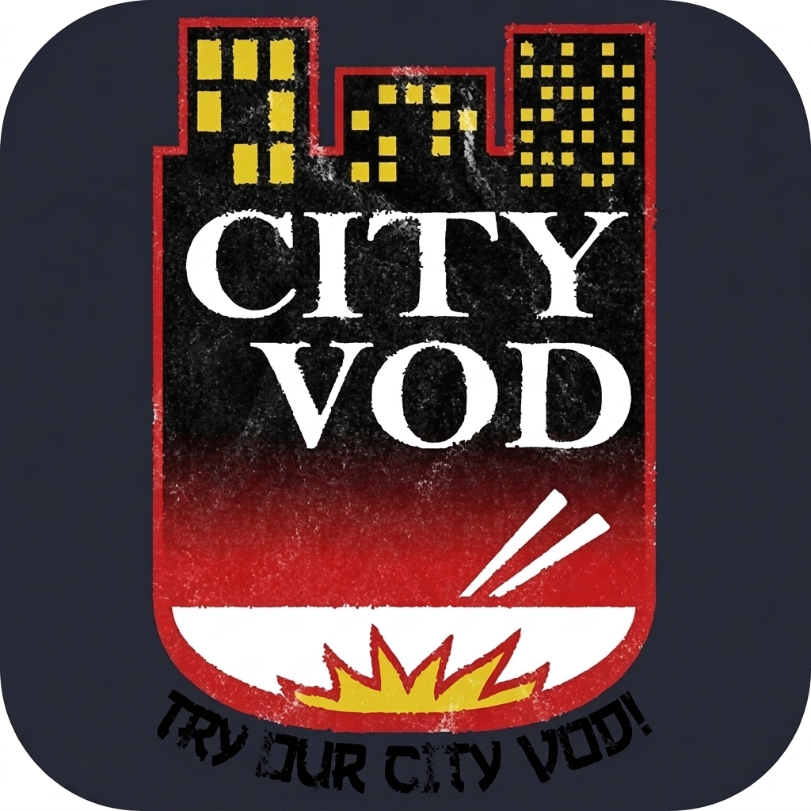

# City VOD – South Park Studios for iOS 6

<p align="center">
  
  <br>
  <b>"TRY OUR CITY VOD!"</b>
</p>

Unofficial, universal (iPhone + iPad) [South Park Studios](https://www.southparkstudios.com) client for **jailbroken iOS 6.x** devices (armv7, e.g. iPad 2, iPhone 4S, iPhone 5), with a second build for **64-bit devices with iOS 14–17** (rootless jailbreaks and TrollStore) that preserves the authentic skeuomorphic iOS 6 look and feel.

Watch full episodes across all seasons (Season 1 to Season 27+), clips, and specials with synchronized subtitles, resume support, and background audio. Full English and Czech localization. No account required: streams are fetched from public web endpoints.

---

## Why It Is Special

Legacy devices running iOS 6 face significant hurdles on the modern web:
1. **Modern TLS**: Modern CDN edge servers (Akamai, Paramount, Cloudflare) require TLS 1.2 or 1.3 with modern SNI and cipher suites. iOS 6's built-in CFNetwork stack cannot negotiate modern handshakes.
2. **HLS Playback & Tag Compatibility**: Modern HLS streams from Paramount include tags (`#EXT-X-VERSION > 4`, `#EXT-X-SESSION-KEY`, `#EXT-X-DEFINE`, `#EXT-X-MEDIA`) that crash or stall iOS 6 `AVPlayer`.
3. **Authentication & Token Expiry**: Stream tokens issued by the `mica.json` endpoint expire in ~4.5 minutes (`expirydateepoch`). Without dynamic token management, playback terminates mid-episode.
4. **Subtitles**: Native iOS 6 `AVPlayer` cannot reliably render WebVTT sidecar tracks.

### The City VOD Solution:
- **Embedded Mbed TLS 3.6.7**: Ships a complete, self-contained TLS stack with an up-to-date Mozilla root certificate authority bundle.
- **Local HTTP Proxy (`127.0.0.1`)**: A lightweight in-app proxy (`CVMediaProxy`) intercepts requests for `AVPlayer`. It rewrites playlists on the fly, strips incompatible tags, caps resolution/bitrate to device decoding capabilities (e.g. 720p H.264 Main@3.1 on iPad 2), and relays RFC 8216 AES-128 decryption keys and media segments with desktop browser headers.
- **Dynamic Token Re-resolution**: The player monitors token expiration and transparently re-resolves stream tokens without disrupting playback.
- **Custom WebVTT Caption View**: Downloads subtitle playlists, parses WebVTT cues, and synchronizes text rendering in a responsive overlay (`CVCaptionView`).
- **WebP Image Support**: Bundles `libwebp 1.5.0` to decode modern image formats directly into `UIImage`.

---

## Features

- **Home**: "Continue Watching" carousel with progress indicators, latest clips, and featured episodes.
- **Seasons & Episodes**: Browse all 27+ seasons, view episode titles, season/episode numbers, original air dates, and synopses.
- **Clips**: Library of highlights and memorable South Park scenes.
- **Search**: Instant offline-cached search across all seasons and clips.
- **Library**:
  - **Favorites**: Star episodes to save them for easy access.
  - **History**: Automatically tracks playback progress, marks completed episodes (>92%), and offers "Resume from MM:SS".
  - Swipe-to-delete and clear history.
- **Full-featured Player**:
  - Fullscreen landscape mode with custom glossy controls.
  - Act markers (chapters parsed from `mica.json`) for quick navigation between episode segments.
  - Scrubber with elapsed and remaining timestamps, ±15s jump buttons.
  - Quality selector (Auto capability-filtered, Source, 1080p, 720p, 480p, 360p).
  - Subtitle toggle (CC) and audio language selector (English / Español where available).
  - Background audio playback (`UIBackgroundModes: audio`) and lock-screen Now Playing controls.
- **Themes & Localization**:
  - Dark (default) and Light themes featuring City VOD crimson red accents.
  - Full English and Czech (`cs`) translations.

---

## Installation

### Via Cydia / Sileo / Zebra Repository
Add the repository:
```
http://repo.samcejko.eu/
```
Search for **City VOD** and install.

### Manual Installation (.deb / .ipa)
1. Ensure your device has **AppSync Unified** (from `https://cydia.akemi.ai/`).
2. Download the latest `.deb` or `.ipa` from the [Releases](https://github.com/samcejko/southpark-ios6/releases) page.
3. Install via `dpkg -i com.samcejko.cityvod_*.deb` or with **IPA Installer Console** / 3uTools.

### iOS 14–17 (64-bit / TrollStore)
- On rootless jailbreaks (Dopamine / Palera1n), install the `iphoneos-arm64` `.deb` through Sileo.
- On non-jailbroken devices with **TrollStore**, install `CityVOD-<version>-arm64.ipa`.

---

## Building from Source

Builds are automated via GitHub Actions on Ubuntu using [Theos](https://theos.dev):

### 32-bit iOS 6 (armv7)
```bash
export THEOS=/path/to/theos
make clean
make package
```
Generates `packages/com.samcejko.cityvod_<version>_iphoneos-arm.deb` targeting iOS 6.0–10.x.

### 64-bit iOS 14+ (arm64 Rootless / TrollStore)
```bash
export THEOS=/path/to/theos
make clean
make package THEOS_PACKAGE_SCHEME=rootless
```
Generates `packages/com.samcejko.cityvod_<version>_iphoneos-arm64.deb` and TrollStore-compatible IPA.

---

## Disclaimer & Fair Use Notice

**City VOD** is an independent, non-commercial, open-source fan project created solely for historical preservation, accessibility, and interoperability on legacy iOS hardware. 

- This application is **not** endorsed by, associated with, or affiliated with South Park Digital Studios LLC, Paramount Global, Comedy Partners, or MTV Entertainment Studios.
- "South Park", character likenesses, and related marks are trademarks of Comedy Partners and Paramount Global.
- The "City VOD" name and icon are a parody tribute to the fictional "City Wok" restaurant from the show.
- This software **does not** bypass DRM, crack encryption, or provide unauthorized access to paid content. It accesses public, free-to-stream web endpoints provided by `southparkstudios.com` in supported regions without circumvention of copy protection.

---

## License

This project is licensed under the [MIT License](LICENSE).
Embedded third-party libraries:
- [Mbed TLS](https://github.com/Mbed-TLS/mbedtls) (Apache-2.0)
- [libwebp](https://chromium.googlesource.com/webm/libwebp) (BSD-3-Clause)
